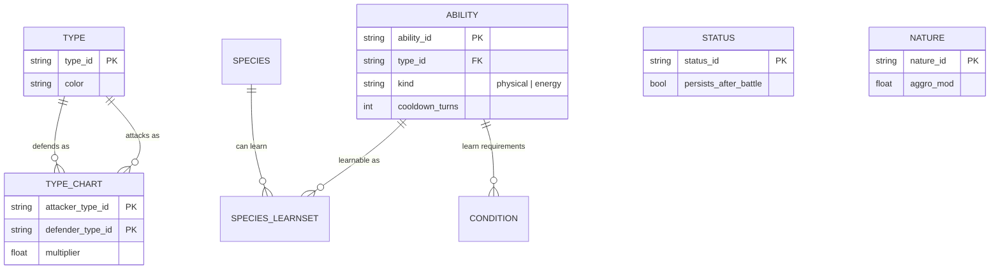
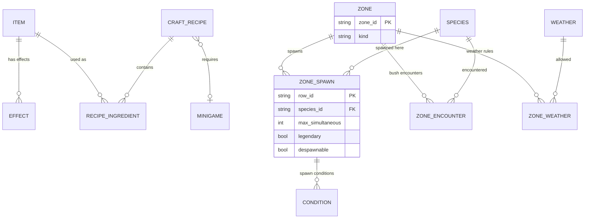

# Слой 1 — Схема данных: ER-диаграмма и спецификация

> **Статус:** согласовано разработчиком (14.10.2026). Все 13 решений приняты (§5).
> **Назначение:** единственный источник истины по структуре данных
> (правило закреплено в `AGENTS.md` §5): любое изменение `Data/`, C++ row-структур
> или save-схемы обязано сопровождаться правкой этого документа **в том же коммите**.
> **Форматы:** CSV в `Data/` — истина (ADR-003); импорт в DataTable — производная операция.
> **Обсуждение:** ветка `docs/layer1-data-schema`; комментарии — §8.

---

## 1. Принципы

1. **Шаблон ≠ инстанс.** `species` — определение вида (статичные данные в `Data/`);
   конкретный покемон игрока/мира — `creature_instance` в SaveGame (§4). Никогда не смешивать.
2. **ID — namespaced slug:** `species.bulbasaur`, `ability.flamethrower`,
   `item.potion_s`, `zone.route01_grass`. Стабильны, не переиспользуются;
   переименование = миграция данных. Синтаксис совпадает с GameplayTags (без расхождений в будущем).
3. **Универсальные Condition / Effect** вместо таблицы на каждый кейс — строки в
   `Rules/conditions.csv` и `Rules/effects.csv` с полиморфным владельцем
   (`owner_type` + `owner_id`). Семантика по умолчанию — **AND** (все условия владельца);
   варианты «ИЛИ» — несколько строк-владельцев (например, несколько `evolution` от одного вида).
   Новые WIP-механики покрываются новыми *типами* условий/эффектов, а не миграцией структуры.
4. **`tags[]`** на ключевых сущностях — будущие флаги без миграции.
5. **Текст — истина (ADR-003).** Ссылки на ассеты — строковые пути `Content/...` в CSV.
6. **Формулы в C++, параметры — в данных.** Базовые формулы (урон, поимка, рост статов) —
   тестируемый C++ (AGENTS §6); коэффициенты и веса — `Balance/gameplay_config.csv`;
   кривые от уровня — UE CurveTable (CSV-импорт, правка **без пересборки**).
   Выражения-как-данные — только отдельным ADR, если параметров станет мало.
7. **Версионирование сохранений:** в save — `schema_version` (структура) и
   `balance_version` (баланс); миграции — явные функции на C++ по версиям;
   автопересчёт накопленных значений — только там, где правило миграции это говорит явно.

---

## 2. ER-диаграммы

### 2.1 Бой и типы



### 2.2 Виды покемонов


### 2.3 Предметы и мир



> Границы зон в CSV не хранятся: geometry — volume-актор в уровне со ссылкой `zone_id` (решение №6).

### 2.4 NPC, квесты, активности, механизмы


> `CONDITION`, `EFFECT`, `REWARD` — полиморфные владельцы (все домены);
> связи к ним на диаграммах других блоков не дублируются ради читаемости.

---

## 3. Спецификация таблиц

Обозначения: `(PK)` — часть первичного ключа, `(FK)` — ссылка на ID другой таблицы.
`name_key`/`desc_key` — ключи в `Meta/loc.csv` (решение №5).

### A. `Data/Types/` и `Data/Battle/`

| Таблица | Колонки | Заметки |
|---|---|---|
| `type` | `type_id (PK)`, `name_key`, `color (hex)`, `tags` | 12 типов (GDD) |
| `type_chart` | `attacker_type_id (PK,FK)`, `defender_type_id (PK,FK)`, `multiplier` | **полная сетка 12×12 = 144 строки** (№3); до 2 типов у существа → итог = произведение двух строк; значения 0/0.25/0.5/1/2/4 |
| `status` | `status_id (PK)`, `name_key`, `battle_duration`, `persists_after_battle (bool)`, `cure_method`, `tags` | эффекты статуса — строки `Rules/effects` (owner=status); «не проходит после боя» ✓ GDD |
| `nature` | `nature_id (PK)`, `name_key`, `anim_profile`, `aggro_mod`, `flee_mod`, `chase_time_mod`, `herd (bool)`, `sleeps (bool)`, `tags` | характер **не влияет на статы** (GDD) — только поведение/анимации |

### B. `Data/Abilities/`

Термин **Ability** (решение №10; рус. «способность» — термин GDD).

| Таблица | Колонки | Заметки |
|---|---|---|
| `ability` | `ability_id (PK)`, `name_key`, `desc_key`, `type_id (FK)`, `kind (physical\|energy)`, `power`, `accuracy`, `cooldown_turns`, `cast_turns`, `recovery_turns`, `target_scope (self\|ally\|enemy\|selectable)`, `usable_out_of_battle (bool)`, `formula_ref`, `tags` | GDD: тип у каждой атаки один, всегда есть; ≤5 одновременно у покемона, переучивание — runtime. Побочные эффекты, шанс промаха, отложенные эффекты, применение вне боя = строки `Rules/effects` (owner=ability) + колонки выше. **Требования изучения** = `Rules/conditions` (owner=ability) — отдельно от learnset вида (восстановлено после разбора чужой схемы) |

### C. `Data/Species/` (+ подпапки)

Хаб + child-таблицы (решение №7).

| Таблица | Колонки | Заметки |
|---|---|---|
| `species` | `species_id (PK)`, `name_key`, `desc_key`, `type1_id (FK)`, `type2_id (FK?)`, `gender_ratio (float?; null = бесполые)`, `base_catch_rate (int)`, `capture_difficulty (float)`, `size_min`, `size_max`, `base_tint (hex)`, `mutation_slots_max (int)`, `aggro_radius`, `flee_radius`, `herd (bool)`, `sleep_by_time (bool)`, `legendary (bool)`, `rideable (bool)`, `ride_speed (float?)`, `base_friendship (int)`, `model_path`, `skeleton_path`, `anim_path`, `tags` | дефолты поведения; зона может их переопределить (GDD) |
| `species_stat_range` | `species_id (PK,FK)`, `stat (PK: hp\|attack\|defense\|sp_attack\|sp_defense\|speed)`, `min`, `max`, `growth_weight` | EAV-строки: диапазоны вида + пул очков; формула от уровня — C++ (принцип 6) |
| `species_learnset` | `species_id (PK,FK)`, `ability_id (PK,FK)`, `method (level\|tutor\|event)`, `level?` | «у каждого вида свой диапазон навыков»; условия вхождения — `Rules/conditions` (owner=строка learnset) |
| `evolution` | `evolution_id (PK)`, `from_species_id (FK)`, `to_species_id (FK)`, `branch_order (int)` | «ИЛИ» = несколько строк от одного from; **критерии** (уровень, время суток, дружба, предмет, счётчики, победы…) = `Rules/conditions` (owner=evolution); жёсткий список to ✓ GDD |
| `mutation` | `mutation_id (PK)`, `name_key`, `affected_parts[]`, `visual_ref`, `hidden (bool)`, `tags` | стат-модификаторы — `Rules/effects` (owner=mutation); `hidden` — скрытые мутации из WIP-размножения |
| `Species/Mutations/species_mutation` | `species_id (PK,FK)`, `mutation_id (PK,FK)`, `weight?` | допустимый набор мутаций вида; лимит — `species.mutation_slots_max` |
| `Species/Pigments/species_pigment` | `species_id (PK,FK)`, `tint_min (hex)`, `tint_max (hex)`, `texture_ref?` | базовый оттенок — `species.base_tint` |
| `species_cosmetic` | `species_id (PK,FK)`, `slot_id (PK,FK → Meta/cosmetic_slot)` | разблокированные слоты вида |
| `species_food` | `species_id (PK,FK)`, `item_id (PK,FK)`, `preference (int)` | предпочтения по еде |
| `species_breeding` | `species_id (PK,FK)` | **таблица-владелец**: строки `Rules/conditions` (owner=`breeding:<species>`) хранят ограничения на партнёра (GDD) |
| `alt_art` | `alt_art_id (PK)`, `species_id (FK)`, `model_ref`, `texture_ref`, `acquisition (event:<id>\|rule)` | альт-арт/временные события; **слот под мега-эволюции/формы (WIP)** |

### D. `Data/Items/`

| Таблица | Колонки | Заметки |
|---|---|---|
| `item` | `item_id (PK)`, `name_key`, `desc_key`, `category (consumable\|pokeball\|stone\|quest\|drop\|material\|cosmetic)`, `price (int)`, `stackable (bool)`, `max_stack`, `sellable (bool)`, `icon_ref`, `tags` | **одна цена на покупку и продажу** (GDD), одинаковая для всех NPC; квестовые (`quest`) нельзя продать — валидатор проверяет `sellable=0`; эффекты (зелья/ягоды/покеболы→capture_bonus/камни→trigger_evolution/косметика→equip_slot) = `Rules/effects` (owner=item) |
| `craft_recipe` | `recipe_id (PK)`, `result_item_id (FK)`, `result_count`, `minigame_id (FK)`, `tags` | разблокировка — `Rules/conditions` (owner=recipe); эпик крафта — отдельный слой (GDD) |
| `recipe_ingredient` | `recipe_id (PK,FK)`, `item_id (PK,FK)`, `count` | |

### E. `Data/Meta/` и `Data/Balance/`

| Таблица | Колонки | Заметки |
|---|---|---|
| `Balance/gameplay_config` | `key (PK)`, `value`, `comment` | константы: `party_size=6`, `ability_slots_max=5`, `active_creatures_max=2`, дистанции деспавна, параметры формул, коэффициенты поимки (правка без пересборки, принцип 6) |
| `Meta/currency` | `currency_id (PK)`, `name_key`, `icon_ref`, `tags` | «деньги и прочие валюты» (GDD) |
| `Meta/appearance_option` | `option_id (PK)`, `category (hair\|eyes\|face\|makeup\|body)`, `visual_ref`, `gender?`, `tags` | каталог вариантов внешности игрока и NPC |
| `Meta/cosmetic_slot` | `slot_id (PK)`, `domain (character\|creature)`, `sort` | фиксированные списки слотов из GDD (персонаж 12, покемон 6) |
| `Meta/loc` | `key (PK)`, `ru`, `en?` | отдельный слой локализации (№5) |

### F. `Data/Zones/` и `Data/World/`

| Таблица | Колонки | Заметки |
|---|---|---|
| `zone` | `zone_id (PK)`, `name_key`, `kind (spawn\|encounter\|weather\|mixed)`, `overrides (напр. override_tint)`, `tags` | **конфиг в CSV, геометрия — volume-актор в уровне со ссылкой `zone_id`** (№6) |
| `zone_spawn` | `row_id (PK)`, `zone_id (FK)`, `species_id (FK)`, `weight`, `max_simultaneous`, `despawn_distance`, `despawn_time`, `legendary (bool)`, `despawnable (bool)`, `override_tint?` | условия — `Rules/conditions` (owner=строка); **легендарные = те же строки**: `legendary=1`, `despawnable=0`, условия появления (GDD) |
| `zone_encounter` | `row_id (PK)`, `zone_id (FK)`, `species_id (FK)`, `level_min`, `level_max`, `weight` | «кусты» — случайные нападения; условия — `Rules/conditions` |
| `zone_weather` | `zone_id (PK,FK)`, `weather_id (PK,FK)`, `interval_min_s`, `interval_max_s`, `weight` | вручную настраиваемые диапазоны и интервалы (GDD) |
| `weather` | `weather_id (PK)`, `name_key`, `vfx_ref`, `tags` | боевые/мир-эффекты — `Rules/effects` (owner=weather) |
| `World/time_of_day` | `phase_id (PK)`, `duration_s`, `light_preset` | глобальные интервалы — в `Balance`; условие `time_of_day` читает отсюда |
| `World/teleport` | `teleport_id (PK)`, `kind (skill\|object)`, `from_anchor`, `to_anchor`, `route_ref?`, `tags` | корабли/поезда = kind=object с маршрутом; навык покемона = `ability(usable_out_of_battle, effect=teleport)` (GDD) |
| `World/map_marker` | `marker_id (PK)`, `type`, `anchor`, `label_key` | схематичная карта мира, без миникарты (GDD) |

### G. `Data/NPCs/` и `Data/Quests/`

| Таблица | Колонки | Заметки |
|---|---|---|
| `npc` | `npc_id (PK)`, `name_key`, `appearance[] (option_id)`, `battle_enabled (bool)`, `battle_cooldown_s`, `battle_group_id (FK trainer_group?)`, `shop_id?`, `dialogue_id?`, `icon_flags`, `tags` | **набор** взаимодействий одновременно (talk/battle/trade/quest — не один enum); подсветка иконкой ✓ GDD; placement — anchor в уровне |
| `dialogue_node` | `node_id (PK)`, `dialogue_id`, `seq`, `text_key`, `next_node_id?`, `action?` | реплики вручную + ветвление; условие/квест-триггер — `Rules/conditions` (owner=node) |
| `shop_stock` | `row_id (PK)`, `shop_id`, `item_id (FK)` | условия появления позиции — `Rules/conditions` (owner=строка) |
| `trainer_group` | `group_id (PK)`, `rules_id (FK trainer_rules)`, `tags` | команда-шаблон: NPC и генеративные турниры используют один механизм |
| `trainer_team` | `row_id (PK)`, `group_id (FK)`, `slot`, `species_id (FK)`, `level`, `ability_ids[]`, `nature_id?`, `item_id?`, `tags` | списки — редний контент, валидатор проверяет каждый id |
| `trainer_rules` | `rules_id (PK)`, `max_legendaries`, `level_cap`, `side_count (1..2)` | ограничения боя выставляются вручную (GDD); награды = `reward` (owner=rules) |
| `quest` | `quest_id (PK)`, `kind (story\|daily\|weekly)`, `repeatable (bool)`, `cooldown_s`, `giver_npc_id (FK?)`, `prereq_quest_ids[]`, `template_params (пулы random-целей)`, `tags` | **1 NPC → много квестов**; условия — conditions (owner=quest); награды — reward (owner=quest) |
| `quest_stage` | `stage_id (PK)`, `quest_id (FK)`, `seq` | |
| `quest_objective` | `objective_id (PK)`, `stage_id (FK)`, `type (defeat\|collect\|visit\|talk\|…)`, `target_id`, `count` | случайные переменные daily/weekly — через `template_params` + пул вида/типа (GDD) |
| `reward` | `row_id (PK)`, `owner_type`, `owner_id`, `reward_type (item\|currency\|achievement\|unlock)`, `target_id`, `count`, `chance` | **общий механизм наград**: квесты, NPC, турниры (WIP-место), залы (WIP), достижения, активности |

### H. `Data/Activities/`

| Таблица | Колонки | Заметки |
|---|---|---|
| `tournament_config` | `config_id (PK)`, `generation_params (число тренеров, level range)`, `rules_id (FK)`, `tags` | цепочка тренеров из `trainer_group` (пулы); награды = reward (owner=config) — **место под WIP «Награды»** |
| `roguelike_cave_config` | `config_id (PK)`, `path_params`, `keep_rules`, `tags` | стартовый пул — строки `roguelike_starter`; награды = reward |
| `roguelike_starter` | `config_id (PK,FK)`, `species_id (PK,FK)`, `weight` | «выбор из одного случайного покемона» (GDD) |
| `contest_config` | `config_id (PK)`, `minigame_id (FK)`, `scoring_params`, `tags` | **WIP** (реакционная механика) |
| `minigame` | `minigame_id (PK)`, `kind (reaction\|craft)`, `difficulty_ref`, `tags` | **WIP**; общий для крафта и конкурса |
| `achievement` | `achievement_id (PK)`, `category`, `points`, `hidden (bool)`, `tags` | условия — conditions (owner=achievement); награды — reward (item/постоянный эффект ✓ GDD) |
| `event` | `event_id (PK)`, `kind`, `start_at`, `end_at`, `content_refs[]`, `tags` | временные события; награды — reward; основной источник альт-артов (GDD) |

### R. `Data/Rules/` — универсальные механизмы (решение №2)

| Таблица | Колонки | Заметки |
|---|---|---|
| `condition` | `row_id (PK)`, `owner_type`, `owner_id`, `condition_type`, `params`, `combine (all\|any, default all)` | типы: `level_ge`, `time_of_day`, `weather_is`, `friendship_ge`, `has_item`, `quest_done`, `species_defeated`, `ability_used_n_times`, `species_in_set`, … **новый WIP = новый тип, не миграция** |
| `effect` | `row_id (PK)`, `owner_type`, `owner_id`, `effect_type`, `target`, `params`, `chance`, `duration` | типы: `damage` (формула C++), `apply_status`, `modify_stat`, `buff`, `teleport`, `give_item`, `trigger_evolution`, `capture_bonus`, `equip_slot`, `give_achievement`, … |

`owner_type` — закрытый список доменов (`species`, `species_learnset`, `evolution`, `ability`,
`breeding`, `item`, `status`, `mutation`, `weather`, `zone_spawn`, `zone_encounter`,
`shop_stock`, `dialogue_node`, `quest`, `recipe`, `achievement`, `trainer_rules`, `event`, …);
валидатор проверяет, что `owner_id` существует в указанном домене.

---

## 4. Runtime-слой (SaveGame — не «БД», но контракт)

| Сущность | Состав |
|---|---|
| `player_profile` | `display_name`, `appearance[] (option_id)`, `card_tiles[]` |
| `player_currency` | `(currency_id, balance)` — список балансов |
| `inventory` | `(item_id, count)` — стеки; квестовые помечаются категорией шаблона; банк = отдельный список, партия = слоты 0–5 |
| `creature_instance` | `uuid (PK)`, `species_id`, `nickname?`*, `level`, `xp`, `current_hp`, `stats` (rolled base + trained + боевые модификаторы), `stat_training_points`, `ability_slots[≤5]` + **счётчики использования** (для требований изучения), `nature_id`, `gender`, `friendship`, `size_value`, `pigment_hex`, `mutation_ids[]`, `cosmetics[] (slot→item)`, `status[]` (персистентные до лечения — GDD), `alt_art_id?`, `origin (wild\|bred\|legendary\|event)`, `met_location_id`, `met_date` |
| `pokedex_state` | `(species_id, seen, caught)` |
| `quest_progress` | `(quest_id, stage_seq, counters[])` |
| `achievement_progress` | `(achievement_id, value, done)` |
| `world_state` | время суток, `spawned[zone→instance ids]`, флаги легендарных, override погоды |
| `save_meta` | `schema_version`, `balance_version`, `game_version`, `saved_at`, `playtime_s` — **миграции по версиям (№12)** |

`*` nickname в GDD отсутствует — колонка зарезервирована, не используется до расширения GDD.

## 5. Принятые решения (13/13)

| # | Тема | Решение |
|---|---|---|
| 1 | ID-схема | namespaced slug (`species.bulbasaur`), синтаксис = GameplayTags |
| 2 | Условия/эффекты | построчные `Rules/conditions` + `Rules/effects` (AND; «ИЛИ» = несколько владельцев) |
| 3 | Матрица типов | полная сетка 12×12 = 144 строки |
| 4 | Параметры | частые — типизированные колонки; редкие — `params`-строка |
| 5 | Локализация | отдельный слой `Meta/loc` |
| 6 | Зоны | конфиг в CSV + volume-актор в уровне (`zone_id`), границ не в CSV |
| 7 | Species | хаб + child-таблицы; `Species/Mutations/`, `Species/Pigments/` вложены |
| 8 | `Data/` | база разработчика + домены Battle/World/Activities/Rules/Meta |
| 9 | `Content/` | база разработчика + `Input/`, `Caves→Instances`, `Pokemon/Base` |
| 10 | Термин | **`Ability`** (`Data/Abilities/`), рус. «способность» — термин GDD |
| 11 | Формулы | база в C++ (тесты), параметры/веса в CSV, кривые — CurveTable |
| 12 | Версии save | `schema_version` + `balance_version`, явные C++-миграции, автопересчёт только по правилу |
| 13 | Чужие механики | держимые предметы, яйца, бейджи, фракции, `unlocked_zones`, боксы — **не делаем**; яйца → открытые вопросы |

## 6. Утверждённые каталоги

```text
Data/
├── Species/            # species, species_stat_range, species_learnset, evolution,
│   │                   #   species_cosmetic, species_food, species_breeding, alt_art
│   ├── Mutations/      # mutation, species_mutation
│   └── Pigments/       # species_pigment
├── Types/              # type, type_chart
├── Abilities/          # ability          (эффекты/условия → Rules/)
├── Battle/             # status, nature
├── Items/              # item, craft_recipe, recipe_ingredient
├── Zones/              # zone, zone_spawn, zone_encounter, zone_weather, weather
├── World/              # time_of_day, teleport, map_marker
├── NPCs/               # npc, dialogue_node, shop_stock, trainer_group, trainer_team, trainer_rules
├── Quests/             # quest, quest_stage, quest_objective, reward
├── Activities/         # tournament_config, roguelike_cave_config, roguelike_starter,
│                       #   contest_config, minigame, achievement, event
├── Rules/              # condition, effect
├── Balance/            # gameplay_config
└── Meta/               # loc, currency, appearance_option, cosmetic_slot

Content/
├── Core/               # GameMode, PlayerController, GameState, PlayerState (тонкие BP)
├── Input/              # Input Actions, Mapping Contexts (со Слоя 2)
├── Characters/         # BP_Player, BP_NPC_Base, анимации
├── Pokemon/
│   ├── Base/           # BP_Pokemon_Base, общий скелет/анимации
│   ├── Species/<species_id>/   # уникальные ассеты вида (папка по необходимости)
│   └── Mutations/      # меши/материалы мутаций
├── World/
│   ├── Overworld/      # бесшовная карта
│   └── Instances/      # изолированные зоны (пещеры, интерьеры, спец-зоны)
├── UI/
├── VFX/
└── Audio/
```

Именование ассетов по Epic (`BP_`, `WBP_`, `SM_`, `SK_`, `M_`, `T_`, `S_`, `A_`) —
фиксация на слое «Дизайн».

## 7. Зарезервированные расширения (WIP-слоты)

| WIP из GDD | Где живёт, когда созреет |
|---|---|
| Мега-эволюции / первобытная реверсия | новые строки/таблица рядом с `alt_art` + condition/trigger-типы |
| Награды генеративных турниров | строки `reward` (owner=tournament_config) |
| Мини-игры (реакционные, крафт) | `minigame`, `contest_config`, `craft_recipe.minigame_id` — структура готова, контент WIP |
| Катсцены | уровень контента (Content/), данные — при появлении ТЗ |
| Формат размножения (яйца?) | открытый вопрос `Docs/GDD/99-open-questions.md` #10 |

## 8. Комментарии на ревью

Редактируй таблицу прямо в этом файле (или комментируй в PR ветки `docs/layer1-data-schema`):

| # | Комментарий / правка | Статус |
|---|---|---|
| | | |
