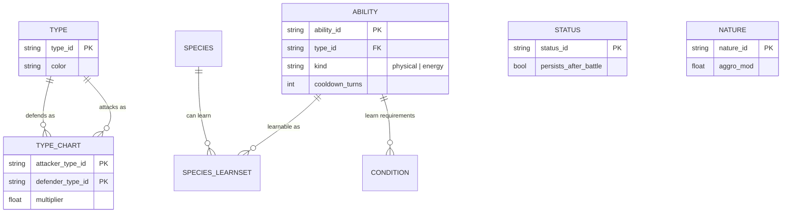
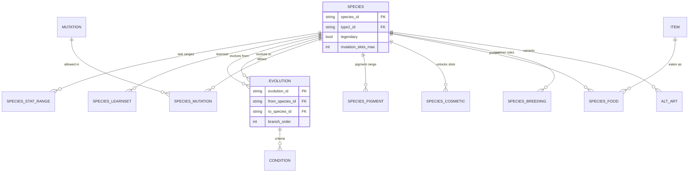
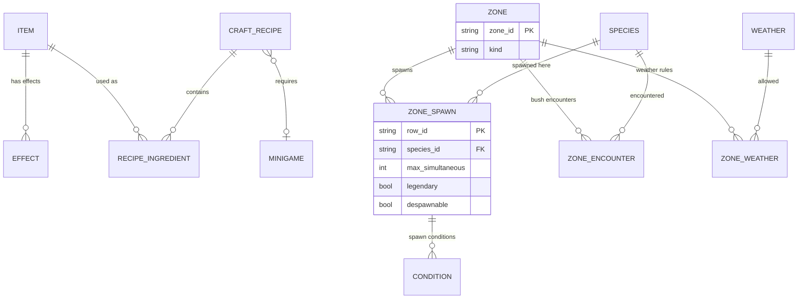
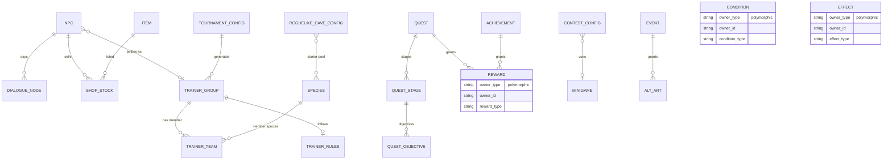

# Слой 1 — Схема данных: ER-диаграмма и спецификация

> **Статус:** согласовано разработчиком (14.10.2026). Все 13 решений приняты (§5).
> **Назначение:** единственный источник истины по структуре данных
> (правило закреплено в `AGENTS.md` §5): любое изменение `Data/`, C++ row-структур
> или save-схемы обязано сопровождаться правкой этого документа **в том же коммите**.
> **Форматы:** CSV в `Data/` — истина (ADR-003); импорт в DataTable — производная операция.
> **Обсуждение:** ветка `docs/layer1-data-schema`; комментарии — §8.

---

## 1. Принципы

1. **Шаблон ≠ инстанс.** `species` — определение вида (статичные данные в `Data/`);
   конкретный покемон игрока/мира — `creature_instance` в SaveGame (§4). Никогда не смешивать.
2. **ID — namespaced slug:** `species.bulbasaur`, `ability.flamethrower`,
   `item.potion_s`, `zone.route01_grass`. Стабильны, не переиспользуются;
   переименование = миграция данных. Синтаксис совпадает с GameplayTags (без расхождений в будущем).
3. **Универсальные Condition / Effect** вместо таблицы на каждый кейс — строки в
   `Rules/conditions.csv` и `Rules/effects.csv` с полиморфным владельцем
   (`owner_type` + `owner_id`). Семантика по умолчанию — **AND** (все условия владельца);
   варианты «ИЛИ» — несколько строк-владельцев (например, несколько `evolution` от одного вида).
   Новые WIP-механики покрываются новыми *типами* условий/эффектов, а не миграцией структуры.
4. **`tags[]`** на ключевых сущностях — будущие флаги без миграции.
5. **Текст — истина (ADR-003).** Ссылки на ассеты — строковые пути `Content/...` в CSV.
6. **Формулы в C++, параметры — в данных.** Базовые формулы (урон, поимка, рост статов) —
   тестируемый C++ (AGENTS §6); коэффициенты и веса — `Balance/gameplay_config.csv`;
   кривые от уровня — UE CurveTable (CSV-импорт, правка **без пересборки**).
   Выражения-как-данные — только отдельным ADR, если параметров станет мало.
7. **Версионирование сохранений:** в save — `schema_version` (структура) и
   `balance_version` (баланс); миграции — явные функции на C++ по версиям;
   автопересчёт накопленных значений — только там, где правило миграции это говорит явно.

---

## 2. ER-диаграммы

### 2.1 Бой и типы



### 2.2 Виды покемонов



### 2.3 Предметы и мир



> Границы зон в CSV не хранятся: geometry — volume-актор в уровне со ссылкой `zone_id` (решение №6).

### 2.4 NPC, квесты, активности, механизмы



> `CONDITION`, `EFFECT`, `REWARD` — полиморфные владельцы (все домены);
> связи к ним на диаграммах других блоков не дублируются ради читаемости.

---

## 3. Спецификация таблиц

Каждая таблица = заголовок «имя + назначение таблицы» (путь к CSV — §6), ниже — **по одной строке на поле**:
колонка «Поле» (имя, `(PK)`/`(FK)`, тип; `?` — может быть пустым, `a\|b\|c` — enum)
и колонка «Описание» — для чего поле. Системная информация по всей таблице —
в «Заметках» под ней. `name_key`/`desc_key` — ключи в `Meta/loc.csv` (решение №5).

### A. `Data/Types/` и `Data/Battle/`

**`type`** — типы существ и способностей

| Поле | Описание |
|---|---|
| `type_id` (PK, string) | стабильный ID типа (`type.fire`) |
| `name_key` (FK, string) | ключ локализации названия |
| `color` (hex) | цвет типа для UI |
| `tags` (tags) | флаги под будущие правила без миграции |

*Заметки: 12 типов (GDD).*

**`type_chart`** — матрица уязвимостей типов друг к другу

| Поле | Описание |
|---|---|
| `attacker_type_id` (PK, FK, string) | тип-нападающий |
| `defender_type_id` (PK, FK, string) | тип-защищающийся |
| `multiplier` (float) | множитель урона: 0 / 0.25 / 0.5 / 1 / 2 / 4 |

*Заметки: **полная сетка 12×12 = 144 строки** (№3); до 2 типов у существа → итог = произведение двух строк.*

**`status`** — боевые статусы и правила их снятия

| Поле | Описание |
|---|---|
| `status_id` (PK, string) | стабильный ID статуса |
| `name_key` (FK, string) | ключ локализации названия |
| `battle_duration` (int) | длительность в ходах боя |
| `persists_after_battle` (bool) | не проходит после боя |
| `cure_method` (string) | чем снимается (действие/предмет) |
| `tags` (tags) | флаги |

*Заметки: эффекты статуса — строки `Rules/effects` (owner=status); «не проходит после боя» ✓ GDD.*

**`nature`** — характеры существ: поведение и анимации

| Поле | Описание |
|---|---|
| `nature_id` (PK, string) | стабильный ID характера |
| `name_key` (FK, string) | ключ локализации названия |
| `anim_profile` (string) | профиль анимаций поведения |
| `aggro_mod` (float) | множитель агрессии |
| `flee_mod` (float) | множитель стремления к побегу |
| `chase_time_mod` (float) | множитель времени погони |
| `herd` (bool) | живёт стадом |
| `sleeps` (bool) | спит по времени суток |
| `tags` (tags) | флаги |

*Заметки: характер **не влияет на статы** (GDD) — только поведение/анимации.*

### B. `Data/Abilities/`

Термин **Ability** (решение №10; рус. «способность» — термин GDD).

**`ability`** — способности существ: боевые атаки и навыки вне боя

| Поле | Описание |
|---|---|
| `ability_id` (PK, string) | стабильный ID способности (`ability.flamethrower`) |
| `name_key` (FK, string) | ключ локализации названия |
| `desc_key` (FK, string) | ключ локализации описания |
| `type_id` (FK, string) | тип способности (всегда один) |
| `kind` (enum physical\|energy) | физический или энергетический урон |
| `power` (int) | сила (урон) |
| `accuracy` (int) | шанс попадания, % |
| `cooldown_turns` (int) | перезарядка, ходов |
| `cast_turns` (int) | время применения, ходов |
| `recovery_turns` (int) | время восстановления после применения, ходов |
| `target_scope` (enum self\|ally\|enemy\|selectable) | область применения |
| `usable_out_of_battle` (bool) | можно применять вне боя |
| `formula_ref` (string) | ссылка на формулу C++ (принцип 6) |
| `tags` (tags) | флаги |

*Заметки: GDD: тип у каждой атаки один, всегда есть; ≤5 одновременно у покемона, переучивание — runtime. Побочные эффекты, шанс промаха, отложенные эффекты, применение вне боя = строки `Rules/effects` (owner=ability) + колонки выше. **Требования изучения** = `Rules/conditions` (owner=ability) — отдельно от learnset вида (восстановлено после разбора чужой схемы).*

### C. `Data/Species/` (+ подпапки)

Хаб + child-таблицы (решение №7).

**`species`** — профиль вида: типы, поведение, размеры, ассеты

| Поле | Описание |
|---|---|
| `species_id` (PK, string) | стабильный ID вида (`species.bulbasaur`) |
| `name_key` (FK, string) | ключ локализации имени |
| `desc_key` (FK, string) | ключ локализации описания |
| `type1_id` (FK, string) | первый тип (обязателен) |
| `type2_id` (FK?, string) | второй тип; пусто = монотип |
| `gender_ratio` (float?) | доля женских особей; null = бесполые |
| `base_catch_rate` (int) | базовый шанс поимки |
| `capture_difficulty` (float) | сложность поимки (вход в формулу) |
| `size_min` (float) | минимальный размер особи |
| `size_max` (float) | максимальный размер особи |
| `base_tint` (hex) | базовый оттенок (его переопределяет зона) |
| `mutation_slots_max` (int) | максимум одновременных мутаций |
| `aggro_radius` (float) | радиус агрессии |
| `flee_radius` (float) | радиус побега |
| `herd` (bool) | живёт стадом (дефолт) |
| `sleep_by_time` (bool) | спит по времени суток (дефолт) |
| `legendary` (bool) | легендарный вид |
| `rideable` (bool) | можно ездить верхом |
| `ride_speed` (float?) | скорость верховой езды |
| `base_friendship` (int) | стартовое значение дружбы |
| `model_path` (string) | путь к мешу в `Content/` |
| `skeleton_path` (string) | путь к скелету в `Content/` |
| `anim_path` (string) | путь к анимационному набору в `Content/` |
| `tags` (tags) | флаги |

*Заметки: дефолты поведения; зона может их переопределить (GDD).*

**`species_stat_range`** — диапазоны прокрутки статов вида

| Поле | Описание |
|---|---|
| `species_id` (PK, FK, string) | вид |
| `stat` (PK, enum hp\|attack\|defense\|sp_attack\|sp_defense\|speed) | какой стат описывают границы |
| `min` (int) | нижняя граница прокрутки базового значения |
| `max` (int) | верхняя граница прокрутки базового значения |
| `growth_weight` (float) | вес роста стата в пуле очков |

*Заметки: EAV-строки: диапазоны вида + пул очков; формула от уровня — C++ (принцип 6).*

**`species_learnset`** — способности, изучаемые видом

| Поле | Описание |
|---|---|
| `species_id` (PK, FK, string) | вид |
| `ability_id` (PK, FK, string) | изучаемая способность |
| `method` (enum level\|tutor\|event) | как изучается |
| `level?` (int) | уровень изучения при `method=level` |

*Заметки: «у каждого вида свой диапазон навыков»; условия вхождения — `Rules/conditions` (owner=строка learnset).*

**`evolution`** — варианты эволюции видов

| Поле | Описание |
|---|---|
| `evolution_id` (PK, string) | стабильный ID эволюции |
| `from_species_id` (FK, string) | исходный вид |
| `to_species_id` (FK, string) | вид-результат |
| `branch_order` (int) | порядок ветвления при нескольких вариантах |

*Заметки: «ИЛИ» = несколько строк от одного from; **критерии** (уровень, время суток, дружба, предмет, счётчики, победы…) = `Rules/conditions` (owner=evolution); жёсткий список to ✓ GDD.*

**`mutation`** — мутации существ: внешние изменения

| Поле | Описание |
|---|---|
| `mutation_id` (PK, string) | стабильный ID мутации |
| `name_key` (FK, string) | ключ локализации названия |
| `affected_parts[]` (string list) | какие части тела затрагивает |
| `visual_ref` (string) | ссылка на визуальный ассет |
| `hidden` (bool) | скрытая (не показывать до WIP-размножения) |
| `tags` (tags) | флаги |

*Заметки: стат-модификаторы — `Rules/effects` (owner=mutation); `hidden` — скрытые мутации из WIP-размножения.*

**`species_mutation`** — допустимые мутации для каждого вида

| Поле | Описание |
|---|---|
| `species_id` (PK, FK, string) | вид |
| `mutation_id` (PK, FK, string) | допустимая мутация |
| `weight?` (float) | вес выпадения при генерации |

*Заметки: допустимый набор мутаций вида; лимит — `species.mutation_slots_max`.*

**`species_pigment`** — диапазоны оттенков окраски вида

| Поле | Описание |
|---|---|
| `species_id` (PK, FK, string) | вид |
| `tint_min` (hex) | нижняя граница оттенка |
| `tint_max` (hex) | верхняя граница оттенка |
| `texture_ref?` (string) | свой текстура поверх оттенка |

*Заметки: базовый оттенок — `species.base_tint`.*

**`species_cosmetic`** — косметика, доступная виду

| Поле | Описание |
|---|---|
| `species_id` (PK, FK, string) | вид |
| `slot_id` (PK, FK → `Meta/cosmetic_slot`) | разблокированный слот внешности |

*Заметки: разблокированные слоты вида.*

**`species_food`** — предпочитаемая видом еда

| Поле | Описание |
|---|---|
| `species_id` (PK, FK, string) | вид |
| `item_id` (PK, FK, string) | съедобный предмет |
| `preference` (int) | приоритет поедания (больше = предпочтительнее) |

*Заметки: предпочтения по еде.*

**`species_breeding`** — правила размножения вида

| Поле | Описание |
|---|---|
| `species_id` (PK, FK, string) | вид-владелец правил размножения |

*Заметки: **таблица-владелец**: строки `Rules/conditions` (owner=`breeding:<species>`) хранят ограничения на партнёра (GDD).*

**`alt_art`** — альтернативные образы вида: события и скины

| Поле | Описание |
|---|---|
| `alt_art_id` (PK, string) | стабильный ID варианта |
| `species_id` (FK, string) | базовый вид |
| `model_ref` (string) | ссылка на модель |
| `texture_ref` (string) | ссылка на текстуру |
| `acquisition` (string) | способ получения: `event:<id>` или `rule` |

*Заметки: альт-арт/временные события; **слот под мега-эволюции/формы (WIP)**.*

### D. `Data/Items/`

**`item`** — каталог предметов: категории, цены, стеки

| Поле | Описание |
|---|---|
| `item_id` (PK, string) | стабильный ID предмета |
| `name_key` (FK, string) | ключ локализации имени |
| `desc_key` (FK, string) | ключ локализации описания |
| `category` (enum consumable\|pokeball\|stone\|quest\|drop\|material\|cosmetic) | категория предмета |
| `price` (int) | цена (одинаковая на покупку и продажу) |
| `stackable` (bool) | стекуется |
| `max_stack` (int) | максимум в стеке |
| `sellable` (bool) | можно продать |
| `icon_ref` (string) | путь к иконке в `Content/` |
| `tags` (tags) | флаги |

*Заметки: **одна цена на покупку и продажу** (GDD), одинаковая для всех NPC; квестовые (`quest`) нельзя продать — валидатор проверяет `sellable=0`; эффекты (зелья/ягоды/покеболы→capture_bonus/камни→trigger_evolution/косметика→equip_slot) = `Rules/effects` (owner=item).*

**`craft_recipe`** — рецепты крафта

| Поле | Описание |
|---|---|
| `recipe_id` (PK, string) | стабильный ID рецепта |
| `result_item_id` (FK, string) | что создаётся |
| `result_count` (int) | сколько штук создаётся |
| `minigame_id` (FK, string) | мини-игра крафта (контент WIP) |
| `tags` (tags) | флаги |

*Заметки: разблокировка — `Rules/conditions` (owner=recipe); эпик крафта — отдельный слой (GDD).*

**`recipe_ingredient`** — ингредиенты рецептов и их количество

| Поле | Описание |
|---|---|
| `recipe_id` (PK, FK, string) | рецепт |
| `item_id` (PK, FK, string) | ингредиент |
| `count` (int) | сколько единиц нужно |

### E. `Data/Meta/` и `Data/Balance/`

**`gameplay_config`** — константы баланса, правятся без пересборки

| Поле | Описание |
|---|---|
| `key` (PK, string) | имя константы |
| `value` (string) | значение (типизируется при чтении) |
| `comment` (string) | пояснение к константе |

*Заметки: константы: `party_size=6`, `ability_slots_max=5`, `active_creatures_max=2`, дистанции деспавна, параметры формул, коэффициенты поимки (правка без пересборки, принцип 6).*

**`currency`** — валюты игры

| Поле | Описание |
|---|---|
| `currency_id` (PK, string) | стабильный ID валюты |
| `name_key` (FK, string) | ключ локализации названия |
| `icon_ref` (string) | путь к иконке |
| `tags` (tags) | флаги |

*Заметки: «деньги и прочие валюты» (GDD).*

**`appearance_option`** — варианты внешности игрока и NPC

| Поле | Описание |
|---|---|
| `option_id` (PK, string) | стабильный ID варианта |
| `category` (enum hair\|eyes\|face\|makeup\|body) | часть внешности |
| `visual_ref` (string) | ссылка на ассет |
| `gender?` (enum male\|female) | ограничение по полу; пусто = оба |
| `tags` (tags) | флаги |

*Заметки: каталог вариантов внешности игрока и NPC.*

**`cosmetic_slot`** — слоты косметики: персонаж и покемон

| Поле | Описание |
|---|---|
| `slot_id` (PK, string) | стабильный ID слота |
| `domain` (enum character\|creature) | слот персонажа или покемона |
| `sort` (int) | порядок отображения |

*Заметки: фиксированные списки слотов из GDD (персонаж 12, покемон 6).*

**`loc`** — строки локализации (ru/en)

| Поле | Описание |
|---|---|
| `key` (PK, string) | ключ строки локализации |
| `ru` (string) | русский текст (язык дизайна) |
| `en?` (string) | английский; пусто = не переведено |

*Заметки: отдельный слой локализации (№5).*

### F. `Data/Zones/` и `Data/World/`

**`zone`** — зоны мира: спавн, кусты, погода

| Поле | Описание |
|---|---|
| `zone_id` (PK, string) | стабильный ID зоны (`zone.route01_grass`) |
| `name_key` (FK, string) | ключ локализации названия |
| `kind` (enum spawn\|encounter\|weather\|mixed) | роль зоны |
| `overrides` (string) | какие дефолты вида переопределяет (напр. `override_tint`) |
| `tags` (tags) | флаги |

*Заметки: **конфиг в CSV, геометрия — volume-актор в уровне со ссылкой `zone_id`** (№6).*

**`zone_spawn`** — спавн видов в зонах

| Поле | Описание |
|---|---|
| `row_id` (PK, string) | стабильный ID строки спавна |
| `zone_id` (FK, string) | зона |
| `species_id` (FK, string) | вид |
| `weight` (int) | вес выпадения при генерации спавна |
| `max_simultaneous` (int) | максимум особей одновременно |
| `despawn_distance` (float) | дистанция деспавна |
| `despawn_time` (float) | время жизни особи, с |
| `legendary` (bool) | легендарная строка спавна |
| `despawnable` (bool) | исчезает ли особь |
| `override_tint?` (hex) | переопределение оттенка вида в зоне |

*Заметки: условия — `Rules/conditions` (owner=строка); **легендарные = те же строки**: `legendary=1`, `despawnable=0`, условия появления (GDD).*

**`zone_encounter`** — случайные встречи в кустах

| Поле | Описание |
|---|---|
| `row_id` (PK, string) | стабильный ID строки |
| `zone_id` (FK, string) | зона |
| `species_id` (FK, string) | вид |
| `level_min` (int) | минимальный уровень |
| `level_max` (int) | максимальный уровень |
| `weight` (int) | вес выпадения |

*Заметки: «кусты» — случайные нападения; условия — `Rules/conditions` (owner=строка).*

**`zone_weather`** — погодный режим зон

| Поле | Описание |
|---|---|
| `zone_id` (PK, FK, string) | зона |
| `weather_id` (PK, FK, string) | допустимая погода |
| `interval_min_s` (int) | минимальный интервал, с |
| `interval_max_s` (int) | максимальный интервал, с |
| `weight` (int) | вес выпадения |

*Заметки: вручную настраиваемые диапазоны и интервалы (GDD).*

**`weather`** — типы погоды в мире

| Поле | Описание |
|---|---|
| `weather_id` (PK, string) | стабильный ID погоды |
| `name_key` (FK, string) | ключ локализации названия |
| `vfx_ref` (string) | ссылка на VFX-эффект |
| `tags` (tags) | флаги |

*Заметки: боевые/мир-эффекты — `Rules/effects` (owner=weather).*

**`time_of_day`** — смена времён суток в мире

| Поле | Описание |
|---|---|
| `phase_id` (PK, string) | стабильный ID фазы |
| `duration_s` (int) | длительность фазы, с |
| `light_preset` (string) | пресет освещения |

*Заметки: глобальные интервалы — в `Balance`; условие `time_of_day` читает отсюда.*

**`teleport`** — перемещения: навыки покемонов и транспорт

| Поле | Описание |
|---|---|
| `teleport_id` (PK, string) | стабильный ID телепорта |
| `kind` (enum skill\|object) | навык покемона или объект мира |
| `from_anchor` (string) | точка отправления |
| `to_anchor` (string) | точка прибытия |
| `route_ref?` (string) | маршрут (для кораблей/поездов) |
| `tags` (tags) | флаги |

*Заметки: корабли/поезда = kind=object с маршрутом; навык покемона = `ability(usable_out_of_battle, effect=teleport)` (GDD).*

**`map_marker`** — метки схематичной карты мира

| Поле | Описание |
|---|---|
| `marker_id` (PK, string) | стабильный ID метки |
| `type` (string) | тип метки |
| `anchor` (string) | привязка в мире |
| `label_key` (FK, string) | ключ подписи |

*Заметки: схематичная карта мира, без миникарты (GDD).*

### G. `Data/NPCs/` и `Data/Quests/`

**`npc`** — персонажи мира и их взаимодействия

| Поле | Описание |
|---|---|
| `npc_id` (PK, string) | стабильный ID NPC |
| `name_key` (FK, string) | ключ локализации имени |
| `appearance[]` (option_id list) | варианты внешности из каталога |
| `battle_enabled` (bool) | может ли драться |
| `battle_cooldown_s` (int) | кулдаун между боями, с |
| `battle_group_id` (FK?, string) | команда для боя; пусто = без боя |
| `shop_id?` (FK, string) | его магазин |
| `dialogue_id?` (FK, string) | его диалог |
| `icon_flags` (tags) | иконки взаимодействий над NPC |
| `tags` (tags) | флаги |

*Заметки: **набор** взаимодействий одновременно (talk/battle/trade/quest — не один enum); подсветка иконкой ✓ GDD; placement — anchor в уровне.*

**`dialogue_node`** — реплики и ветвление диалогов

| Поле | Описание |
|---|---|
| `node_id` (PK, string) | стабильный ID реплики |
| `dialogue_id` (string) | диалог-владелец |
| `seq` (int) | порядок в линейной части |
| `text_key` (FK, string) | текст реплики → `Meta/loc` |
| `next_node_id?` (FK, string) | следующая реплика |
| `action?` (string) | действие при выборе (магазин, выдать квест) |

*Заметки: реплики вручную + ветвление; условие/квест-триггер — `Rules/conditions` (owner=node).*

**`shop_stock`** — товары на полках магазинов

| Поле | Описание |
|---|---|
| `row_id` (PK, string) | стабильный ID строки |
| `shop_id` (string) | магазин-владелец |
| `item_id` (FK, string) | товар |

*Заметки: условия появления позиции — `Rules/conditions` (owner=строка).*

**`trainer_group`** — шаблоны команд тренеров

| Поле | Описание |
|---|---|
| `group_id` (PK, string) | стабильный ID группы |
| `rules_id` (FK → `trainer_rules`) | правила боя |
| `tags` (tags) | метки для пулов генерации |

*Заметки: команда-шаблон: NPC и генеративные турниры используют один механизм.*

**`trainer_team`** — состав команды тренера: слоты и бойцы

| Поле | Описание |
|---|---|
| `row_id` (PK, string) | стабильный ID строки |
| `group_id` (FK, string) | группа |
| `slot` (int) | номер слота в команде |
| `species_id` (FK, string) | вид бойца |
| `level` (int) | уровень бойца |
| `ability_ids[]` (string list) | изученные способности (≤5) |
| `nature_id?` (FK, string) | характер |
| `item_id?` (FK, string) | держимый предмет |
| `tags` (tags) | флаги |

*Заметки: списки — редний контент, валидатор проверяет каждый id.*

**`trainer_rules`** — ограничения боёв тренеров

| Поле | Описание |
|---|---|
| `rules_id` (PK, string) | стабильный ID правил |
| `max_legendaries` (int) | максимум легендарных в команде |
| `level_cap` (int) | потолок уровня |
| `side_count` (int 1..2) | число сторон боя |

*Заметки: ограничения боя выставляются вручную (GDD); награды = `reward` (owner=rules).*

**`quest`** — квесты: типы, выдача, повторы

| Поле | Описание |
|---|---|
| `quest_id` (PK, string) | стабильный ID квеста |
| `kind` (enum story\|daily\|weekly) | тип квеста |
| `repeatable` (bool) | можно ли повторять |
| `cooldown_s` (int) | кулдаун повтора, с |
| `giver_npc_id` (FK?, string) | NPC-задатчик; пусто = не от NPC |
| `prereq_quest_ids[]` (string list) | prerequisite-квесты |
| `template_params` (string) | пулы random-целей для daily/weekly |
| `tags` (tags) | флаги |

*Заметки: **1 NPC → много квестов**; условия — conditions (owner=quest); награды — reward (owner=quest).*

**`quest_stage`** — этапы квестов

| Поле | Описание |
|---|---|
| `stage_id` (PK, string) | стабильный ID этапа |
| `quest_id` (FK, string) | квест |
| `seq` (int) | порядок этапа |

**`quest_objective`** — цели этапов квестов

| Поле | Описание |
|---|---|
| `objective_id` (PK, string) | стабильный ID цели |
| `stage_id` (FK, string) | этап |
| `type` (enum defeat\|collect\|visit\|talk\|…) | тип цели |
| `target_id` (string) | цель (вид, предмет, NPC, зона…) |
| `count` (int) | сколько выполнить |

*Заметки: случайные переменные daily/weekly — через `template_params` + пул вида/типа (GDD).*

**`reward`** — универсальные награды: квесты, NPC, события

| Поле | Описание |
|---|---|
| `row_id` (PK, string) | стабильный ID строки награды |
| `owner_type` (enum, см. §3 R) | домен-владелец |
| `owner_id` (string) | ID владельца в домене |
| `reward_type` (enum item\|currency\|achievement\|unlock) | тип награды |
| `target_id` (string) | что выдаётся |
| `count` (int) | сколько выдаётся |
| `chance` (float) | шанс выпадения, 0..1 |

*Заметки: **общий механизм наград**: квесты, NPC, турниры (WIP-место), залы (WIP), достижения, активности.*

### H. `Data/Activities/`

**`tournament_config`** — конфигурация генеративных турниров

| Поле | Описание |
|---|---|
| `config_id` (PK, string) | стабильный ID конфига |
| `generation_params` (string) | число тренеров, level range |
| `rules_id` (FK → `trainer_rules`) | правила боя |
| `tags` (tags) | метки для пулов |

*Заметки: цепочка тренеров из `trainer_group` (пулы); награды = reward (owner=config) — **место под WIP «Награды»**.*

**`roguelike_cave_config`** — правила процедурных пещер

| Поле | Описание |
|---|---|
| `config_id` (PK, string) | стабильный ID конфига |
| `path_params` (string) | параметры генерации пути |
| `keep_rules` (string) | что сохраняется между заходами |
| `tags` (tags) | флаги |

*Заметки: стартовый пул — строки `roguelike_starter`; награды = reward.*

**`roguelike_starter`** — пул стартовых существ в пещере

| Поле | Описание |
|---|---|
| `config_id` (PK, FK, string) | конфиг пещеры |
| `species_id` (PK, FK, string) | кандидат в стартовые |
| `weight` (int) | вес выпадения |

*Заметки: «выбор из одного случайного покемона» (GDD).*

**`contest_config`** — конфигурация конкурсов

| Поле | Описание |
|---|---|
| `config_id` (PK, string) | стабильный ID конфига |
| `minigame_id` (FK, string) | мини-игра конкурса |
| `scoring_params` (string) | параметры подсчёта очков |
| `tags` (tags) | флаги |

*Заметки: **WIP** (реакционная механика).*

**`minigame`** — общие мини-игры: реакция и крафт

| Поле | Описание |
|---|---|
| `minigame_id` (PK, string) | стабильный ID мини-игры |
| `kind` (enum reaction\|craft) | тип мини-игры |
| `difficulty_ref` (string) | ссылка на кривую сложности |
| `tags` (tags) | флаги |

*Заметки: **WIP**; общий для крафта и конкурса.*

**`achievement`** — достижения: категории и очки

| Поле | Описание |
|---|---|
| `achievement_id` (PK, string) | стабильный ID достижения |
| `category` (string) | категория |
| `points` (int) | очки достижения |
| `hidden` (bool) | скрыто до выполнения |
| `tags` (tags) | флаги |

*Заметки: условия — conditions (owner=achievement); награды — reward (item/постоянный эффект ✓ GDD).*

**`event`** — временные события игры

| Поле | Описание |
|---|---|
| `event_id` (PK, string) | стабильный ID события |
| `kind` (string) | тип события |
| `start_at` (string) | время начала |
| `end_at` (string) | время окончания |
| `content_refs[]` (string list) | подключаемые контенты события |
| `tags` (tags) | флаги |

*Заметки: временные события; награды — reward; основной источник альт-артов (GDD).*

### R. `Data/Rules/` — универсальные механизмы (решение №2)

**`condition`** — универсальные условия для любых владельцев

| Поле | Описание |
|---|---|
| `row_id` (PK, string) | стабильный ID строки |
| `owner_type` (enum, см. ниже) | домен-владелец |
| `owner_id` (string) | ID владельца в домене |
| `condition_type` (string) | тип условия (`level_ge`, `time_of_day`, …) |
| `params` (string) | параметры условия |
| `combine` (enum all\|any, default all) | AND или OR внутри владельца |

*Заметки: типы: `level_ge`, `time_of_day`, `weather_is`, `friendship_ge`, `has_item`, `quest_done`, `species_defeated`, `ability_used_n_times`, `species_in_set`, … **новый WIP = новый тип, не миграция**.*

**`effect`** — универсальные эффекты для любых владельцев

| Поле | Описание |
|---|---|
| `row_id` (PK, string) | стабильный ID строки |
| `owner_type` (enum, см. ниже) | домен-владелец |
| `owner_id` (string) | ID владельца в домене |
| `effect_type` (string) | тип эффекта (`damage`, `apply_status`, …) |
| `target` (string) | цель эффекта |
| `params` (string) | параметры эффекта |
| `chance` (float) | шанс срабатывания, 0..1 |
| `duration` (int) | длительность, если применимо |

*Заметки: типы: `damage` (формула C++), `apply_status`, `modify_stat`, `buff`, `teleport`, `give_item`, `trigger_evolution`, `capture_bonus`, `equip_slot`, `give_achievement`, …*

`owner_type` — закрытый список доменов (`species`, `species_learnset`, `evolution`, `ability`,
`breeding`, `item`, `status`, `mutation`, `weather`, `zone_spawn`, `zone_encounter`,
`shop_stock`, `dialogue_node`, `quest`, `recipe`, `achievement`, `trainer_rules`, `event`, …);
валидатор проверяет, что `owner_id` существует в указанном домене.

---

## 4. Runtime-слой (SaveGame — не «БД», но контракт)

| Сущность | Состав |
|---|---|
| `player_profile` | `display_name`, `appearance[] (option_id)`, `card_tiles[]` |
| `player_currency` | `(currency_id, balance)` — список балансов |
| `inventory` | `(item_id, count)` — стеки; квестовые помечаются категорией шаблона; банк = отдельный список, партия = слоты 0–5 |
| `creature_instance` | `uuid (PK)`, `species_id`, `nickname?`*, `level`, `xp`, `current_hp`, `stats` (rolled base + trained + боевые модификаторы), `stat_training_points`, `ability_slots[≤5]` + **счётчики использования** (для требований изучения), `nature_id`, `gender`, `friendship`, `size_value`, `pigment_hex`, `mutation_ids[]`, `cosmetics[] (slot→item)`, `status[]` (персистентные до лечения — GDD), `alt_art_id?`, `origin (wild\|bred\|legendary\|event)`, `met_location_id`, `met_date` |
| `pokedex_state` | `(species_id, seen, caught)` |
| `quest_progress` | `(quest_id, stage_seq, counters[])` |
| `achievement_progress` | `(achievement_id, value, done)` |
| `world_state` | время суток, `spawned[zone→instance ids]`, флаги легендарных, override погоды |
| `save_meta` | `schema_version`, `balance_version`, `game_version`, `saved_at`, `playtime_s` — **миграции по версиям (№12)** |

`*` nickname в GDD отсутствует — колонка зарезервирована, не используется до расширения GDD.

## 5. Принятые решения (13/13)

| # | Тема | Решение |
|---|---|---|
| 1 | ID-схема | namespaced slug (`species.bulbasaur`), синтаксис = GameplayTags |
| 2 | Условия/эффекты | построчные `Rules/conditions` + `Rules/effects` (AND; «ИЛИ» = несколько владельцев) |
| 3 | Матрица типов | полная сетка 12×12 = 144 строки |
| 4 | Параметры | частые — типизированные колонки; редкие — `params`-строка |
| 5 | Локализация | отдельный слой `Meta/loc` |
| 6 | Зоны | конфиг в CSV + volume-актор в уровне (`zone_id`), границ не в CSV |
| 7 | Species | хаб + child-таблицы; `Species/Mutations/`, `Species/Pigments/` вложены |
| 8 | `Data/` | база разработчика + домены Battle/World/Activities/Rules/Meta |
| 9 | `Content/` | база разработчика + `Input/`, `Caves→Instances`, `Pokemon/Base` |
| 10 | Термин | **`Ability`** (`Data/Abilities/`), рус. «способность» — термин GDD |
| 11 | Формулы | база в C++ (тесты), параметры/веса в CSV, кривые — CurveTable |
| 12 | Версии save | `schema_version` + `balance_version`, явные C++-миграции, автопересчёт только по правилу |
| 13 | Чужие механики | держимые предметы, яйца, бейджи, фракции, `unlocked_zones`, боксы — **не делаем**; яйца → открытые вопросы |

## 6. Утверждённые каталоги

```text
Data/
├── Species/            # species, species_stat_range, species_learnset, evolution,
│   │                   #   species_cosmetic, species_food, species_breeding, alt_art
│   ├── Mutations/      # mutation, species_mutation
│   └── Pigments/       # species_pigment
├── Types/              # type, type_chart
├── Abilities/          # ability          (эффекты/условия → Rules/)
├── Battle/             # status, nature
├── Items/              # item, craft_recipe, recipe_ingredient
├── Zones/              # zone, zone_spawn, zone_encounter, zone_weather, weather
├── World/              # time_of_day, teleport, map_marker
├── NPCs/               # npc, dialogue_node, shop_stock, trainer_group, trainer_team, trainer_rules
├── Quests/             # quest, quest_stage, quest_objective, reward
├── Activities/         # tournament_config, roguelike_cave_config, roguelike_starter,
│                       #   contest_config, minigame, achievement, event
├── Rules/              # condition, effect
├── Balance/            # gameplay_config
└── Meta/               # loc, currency, appearance_option, cosmetic_slot

Content/
├── Core/               # GameMode, PlayerController, GameState, PlayerState (тонкие BP)
├── Input/              # Input Actions, Mapping Contexts (со Слоя 2)
├── Characters/         # BP_Player, BP_NPC_Base, анимации
├── Pokemon/
│   ├── Base/           # BP_Pokemon_Base, общий скелет/анимации
│   ├── Species/<species_id>/   # уникальные ассеты вида (папка по необходимости)
│   └── Mutations/      # меши/материалы мутаций
├── World/
│   ├── Overworld/      # бесшовная карта
│   └── Instances/      # изолированные зоны (пещеры, интерьеры, спец-зоны)
├── UI/
├── VFX/
└── Audio/
```

Именование ассетов по Epic (`BP_`, `WBP_`, `SM_`, `SK_`, `M_`, `T_`, `S_`, `A_`) —
фиксация на слое «Дизайн».

## 7. Зарезервированные расширения (WIP-слоты)

| WIP из GDD | Где живёт, когда созреет |
|---|---|
| Мега-эволюции / первобытная реверсия | новые строки/таблица рядом с `alt_art` + condition/trigger-типы |
| Награды генеративных турниров | строки `reward` (owner=tournament_config) |
| Мини-игры (реакционные, крафт) | `minigame`, `contest_config`, `craft_recipe.minigame_id` — структура готова, контент WIP |
| Катсцены | уровень контента (Content/), данные — при появлении ТЗ |
| Формат размножения (яйца?) | открытый вопрос `Docs/GDD/99-open-questions.md` #10 |

## 8. Комментарии на ревью

Редактируй таблицу прямо в этом файле (или комментируй в PR ветки `docs/layer1-data-schema`):
комментарий к полю — указывай **таблицу и имя поля** (например, `ability.power`).

| # | Комментарий / правка | Статус |
|---|---|---|
| | | |
